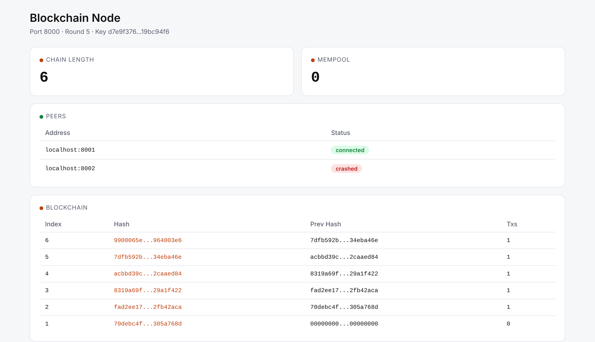

# Blockchain Node

A simplified blockchain network where multiple nodes run locally, exchange transactions, and reach consensus on new blocks.



## About

Each node maintains its own copy of the blockchain, accepts transactions, proposes blocks, and communicates with peers to reach consensus. The system demonstrates core distributed systems concepts: chain validation, hash-linked blocks, round-based consensus, mempool management, and peer-to-peer proposal exchange.

A web dashboard was added separately to visualise each node's chain state, mempool, and connected peers.

## How to Run

```bash
./blockchain.sh setup          # create venv and install dependencies
./blockchain.sh start 3        # start 3 nodes (ports 8000, 8001, 8002)
./blockchain.sh status         # check running nodes
./blockchain.sh logs 8000      # tail logs for a specific node
./blockchain.sh stop           # stop all nodes
```

Each node gets a dashboard at `http://localhost:<port + 1000>`.

## Architecture

| Module | Responsibility |
|--------|---------------|
| `blockchain.py` | Chain state, block validation, serialisation |
| `consensus.py` | Round-based consensus: propose → decide → commit |
| `block.py` | Block data structure |
| `transaction.py` | Transaction data structure |
| `mempool.py` | Pending transaction pool, committed transaction cleanup |
| `network.py` | Peer-to-peer communication and proposal exchange |
| `node.py` | Node orchestration — ties all modules together |
| `api.py` | Web dashboard and REST endpoints |
| `utils.py` | Hashing utilities |

## Key Concepts Implemented

- **Hash-linked chain** — each block stores the hash of the previous block, forming an immutable sequence
- **Chain validation** — verifies index continuity, hash linkage, and genesis block consistency across the full chain
- **Round-based consensus** — nodes propose blocks from their mempool, validate peer proposals, and commit the decided block
- **Peer discovery** — nodes are configured with peer lists and exchange block proposals with all connected peers; a transaction stays in the mempool of the node that received it and reaches the others through that node's block proposal
- **Genesis block** — deterministic creation ensures all nodes start from the same state
- **Crash detection and reconnection** — a peer that does not respond within 2 seconds during a consensus round is marked as crashed and excluded from that round; the node retries crashed peers every 5 seconds
- **Signed transactions** — each transaction carries an Ed25519 signature, and only correctly signed transactions with the expected per-sender nonce enter the mempool

## Course Context

Built for COMP3221 (Distributed Systems) at the University of Sydney, 2026. Scored 96/100.

## Transparency

This project was built with significant assistance from Claude Code (AI coding tool). The web dashboard (`api.py`) was not part of the original assignment scope — I added it afterward because I wanted users to be able to see what each node is doing. The core distributed systems concepts (consensus rounds, chain validation, peer communication) are what I studied and understood through the course.

## What I'd do differently today

- **Handle Byzantine faults:** The node already tolerates crash faults (peers that stop responding), but it still assumes every responding peer is honest. A Byzantine fault tolerant protocol (like PBFT) would also handle peers that send conflicting or malicious proposals.
- **Separate the dashboard:** `api.py` bundles REST endpoints and HTML rendering. Splitting the API layer from the frontend would make each easier to extend independently.
